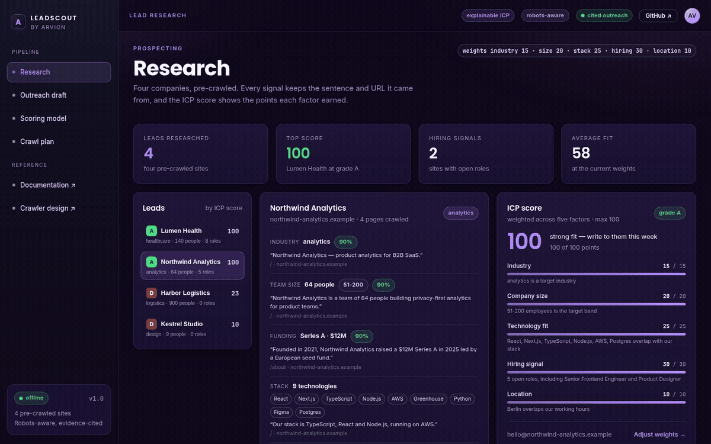
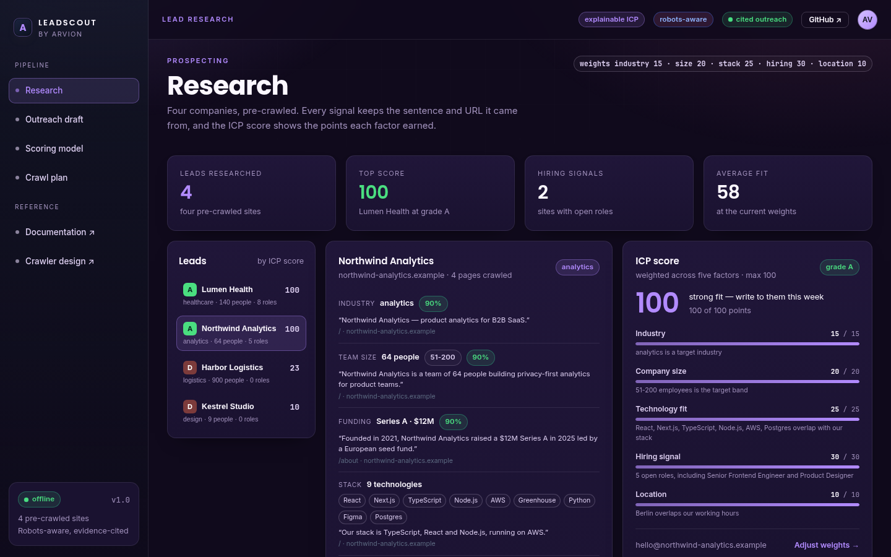
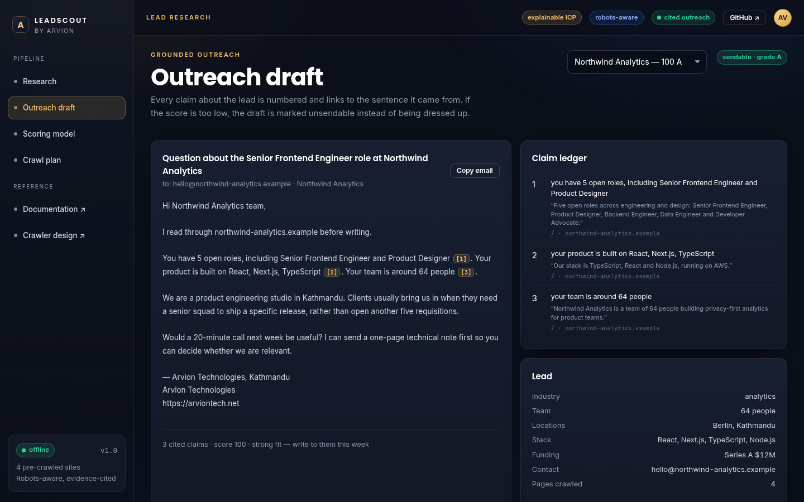

<div align="center">

</div>

<sub>Recorded from the live demo — <a href="docs/demo.mp4">MP4</a> · <a href="docs/screenshot.png">static frame</a></sub>

# LeadScout

Research a company website, score the fit against an ideal-customer profile, and
draft an outreach email where every claim about the company is cited back to the
sentence it came from. The crawler plans around robots.txt before it fetches
anything; the scorer shows the points behind the number; the composer refuses to
write a claim it cannot source.

[**Live demo**](https://arvion-technology.github.io/labs/demos/leadscout/demo/) · [MIT](LICENSE)

---

Outreach tools tend to be either a scraper that produces unsourced "insights" or
a model that writes confident prose about a company it has not read. Both are
hard to check. LeadScout is built around a simpler contract: each signal is a
value plus a URL and a quote, each score is a sum of five visible factors, and
each email sentence about the lead carries a citation number that resolves to
one of those quotes. If the material is not there, the draft is marked unsendable
rather than filled with plausible-sounding filler.

The demo runs on four pre-crawled fictional company sites, so everything is
reproducible and no live requests are made.

## What it does

- **Plans a crawl** around robots.txt: user-agent groups, wildcards, longest-match
  rules, crawl delay, depth and a page budget — with every skipped URL kept and
  explained.
- **Extracts signals** from marketing HTML: industry, team size, funding,
  technology stack, hiring activity and job titles, office locations, and contact
  routes.
- **Scores ICP fit** with five weighted factors, each with points, a maximum and
  the evidence that earned them.
- **Drafts grounded outreach** from the strongest cited factors, with a claim
  ledger and an explicit unsendable state below the score threshold.
- **Re-ranks on the fly** in the demo's scoring screen: move a weight and every
  lead is re-scored, re-ordered and re-explained.
- **Shows the crawl plan** for each site: which paths are fetched, which are
  blocked, and by which rule.

## Screenshots

| Research screen | Grounded outreach draft |
| --- | --- |
|  |  |

## Architecture

```
  src/fixtures.js     4 pre-crawled sites: robots.txt + pages of HTML
          │
          ▼
  src/robots.js       parse groups/rules → longest-match allow decision
          │
          ▼
  src/crawl.js        plan: robots × depth × page budget × crawl delay
          │
          ▼
  src/signals.js      HTML → industry, size, funding, stack, hiring,
          │           locations, contact; every value keeps {url, quote}
          ▼
  src/score.js        5 weighted factors → 0-100 + grade + explanation
          │
          ▼
  src/email.js        claims from positive factors → subject/body + ledger
          │           no evidence means no claim, and no claim means unsendable
          ├── demo/app.js    research, outreach, scoring, crawl screens
          └── test/          52 node:test cases
```

The demo imports `src/` directly. The scoring sliders call the same
`scoreLead()` function the tests use, so the ranking on screen cannot drift from
the ranking the tests assert on.

## Quickstart

```bash
git clone https://github.com/arvion-technology/leadscout.git
cd leadscout
npm test          # 52 tests, no dependencies, Node 20+
npm run demo      # static server on http://localhost:4173
```

Using the pipeline from Node:

```js
import { siteById } from "./src/fixtures.js";
import { extractSignals } from "./src/signals.js";
import { scoreLead } from "./src/score.js";
import { composeEmail } from "./src/email.js";
import { crawlPlan } from "./src/crawl.js";

const site = siteById("northwind-analytics");
const plan = crawlPlan(site, { maxDepth: 1, maxPages: 5 });
console.log(plan.queue.map((page) => page.path));     // [ '/', '/about', '/careers' ]

const signals = extractSignals(site);
const score = scoreLead(signals);
console.log(score.score, score.grade);                // 100 'A'

const email = composeEmail(signals, score);
console.log(email.subject);
console.log(email.claims.map((claim) => claim.citation.quote));
```

To crawl a real site, fetch `https://<domain>/robots.txt`, plan the URLs with
`crawlPlan`, and pass each fetched page through the same `extractSignals` shape.
The fixture schema is the crawler's output contract; this repository ships no
live fetch loop.

## How it works

### robots.txt: the decision, not just the file

`parseRobots` builds user-agent groups, then `isAllowed` takes the longest
matching path rule and gives `Allow` the tie. That is the behaviour most crawlers
implement, and it matters in practice: `Disallow: /careers` with
`Allow: /careers/engineering` should still let you read the engineering roles.
An empty `Disallow:` is treated as allow-all rather than as a rule that matches
every path — a small detail that would otherwise block an entire site.

The plan is a list of decisions, not a list of URLs:

```
path      depth  decision  reason
/         0      fetch     no matching rule
/careers  1      fetch     no matching rule
/admin    1      skip      disallowed by rule (disallow: /admin)
```

### Signals carry their own evidence

Every extractor returns `{value, confidence, evidence: {url, quote}}`, where the
quote is a sentence from the page. The demo shows the quote under the value and
the email composer copies it into the citation ledger. Evidence is the reason the
claims are checkable: a lead that says "64 people" can be traced to the sentence
"Northwind Analytics is a team of 64 people…".

The extractors are heuristics, and the repository is honest about that: team size
comes from number-plus-people patterns, locations from a city gazetteer, industry
from keyword counts, hiring from job-title headings and "N open roles" sentences.
Those are the parts a production system would replace with an LLM extractor
before the scoring layer — the output shape stays the same.

### The score is a sum of five visible factors

Default weights add to 100:

| factor | max | what earns points |
| --- | --- | --- |
| Industry | 15 | exact target industry; half for an adjacent one |
| Company size | 20 | target band; half for one band away |
| Technology | 25 | one third of the weight per matching technology, capped |
| Hiring | 30 | 4+ roles full, 2–3 roles 70%, 1 role 40% |
| Location | 10 | a city in the target list; 30% for elsewhere |

The score is `points / sum(weights) × 100`, so weights can be changed without
breaking the scale. The four fixtures rank Lumen Health and Northwind Analytics
as grade A, Harbor Logistics C/D and Kestrel Studio D — which is the point: a
logistics company with 900 employees and no engineering hiring is not a buyer for
a product engineering retainer, however large it is.

### Outreach refuses to invent

`composeEmail` takes the positive factors that have evidence, turns the top three
into sentences, and numbers them. The body is a template around those claims plus
two statements about us (which need no citation, because they are not claims
about the lead). Below a score of 45 — or with no citable claim — the result is
returned with `sendable: false` and a reason. The demo renders that as a red
banner instead of hiding it.

## Tests

```bash
npm test
```

52 tests on `node:test`:

- `robots.test.js` — parsing, wildcards, longest match, allow-tie, empty rules,
  agent groups, crawl delay.
- `signals.test.js` — HTML text extraction, titles, tech detection per fixture,
  size bands, locations, hiring roles, funding, industry, contact routes.
- `score.test.js` — ranking order, factor caps, evidence on positive factors,
  weight changes, grade thresholds, a custom ICP profile.
- `email.test.js` — every citation quote must appear on the cited page, markers
  resolve to the ledger, unsendable drafts are flagged, no-evidence leads produce
  no claims.
- `crawl.test.js` — robots skips, depth, page budget, delay, decision accounting,
  link discovery.

```bash
node scripts/serve-check.mjs    # demo bundle: assets, banner, screenshot
```

## Limitations

- **The crawler is a planner, not a fetcher.** This repository does not make HTTP
  requests. It ships the plan and the extraction contract; a fetch loop with the
  delay and budget applied is deliberately left to the caller.
- **Four fixtures only.** Heuristics tuned against four marketing sites will miss
  plenty on the open web. The confidence values are honest about the parse, not
  calibrated against a labelled set.
- **No LLM, no embeddings.** Industry and hiring detection are keyword and
  markup heuristics. That keeps the demo runnable offline and the score
  explainable, at the cost of recall.
- **No email sending or deliverability tooling.** The output is text you copy; it
  does not integrate with a mail provider, and it does not check whether the
  address bounces.
- **No de-duplication or CRM sync.** Four leads do not need it; a real pipeline
  would.

## Project layout

```text
leadscout/
├── src/
│   ├── fixtures.js    # 4 sites: robots.txt and pre-crawled HTML
│   ├── robots.js      # parser and longest-match allow rules
│   ├── crawl.js       # crawl plan with depth, budget and delay
│   ├── signals.js     # HTML → evidence-carrying signals
│   ├── score.js       # explainable weighted ICP score
│   └── email.js       # grounded composer + claim ledger
├── test/              # 52 node:test cases
├── demo/              # four screens, imports ../src directly
├── scripts/           # serve, screenshot, asset checks
└── docs/              # screenshots
```

## Credits

Built by [Arvion Technologies](https://arviontech.net) in Kathmandu as part of our
open-source [Labs](https://github.com/arvion-technology/labs) series. If your
growth team wants research that can be checked line by line, the evidence model
here is a reasonable starting point.

MIT licensed.
